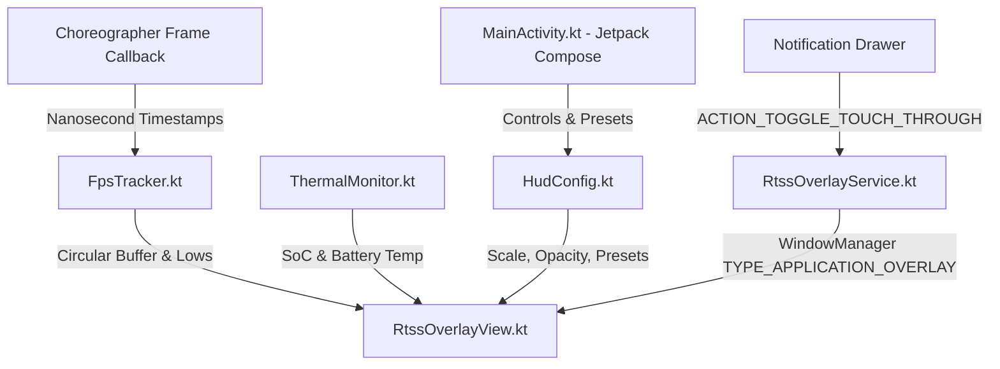

# FPS-Meter 🎮📊

> **A high-performance, low-overhead RTSS-style in-game telemetry HUD for Android.**  
> Monitor real-time FPS, 1% / 0.1% lows, frametime stability graphs, battery drain, and thermal throttling over any mobile game with zero input latency.

[](https://developer.android.com)
[-blue.svg)](https://developer.android.com)
[](LICENSE)
[](https://developer.android.com/jetpack/compose)

---

## ✨ Features

- ⚡ **Zero-Allocation Hot Path**: Custom hardware-accelerated Canvas with strictly zero heap allocations inside `onDraw()` and Choreographer frame callbacks to ensure the HUD never introduces stutters of its own.
- 📈 **RTSS Frametime Graph**: Real-time 120-sample frametime history with color-coded spikes (Green = smooth, Orange = minor drop, Red = severe frame drop) and target refresh rate baselines (16.6ms for 60Hz, 8.3ms for 120Hz).
- 🕹️ **Touch-Through (Click-Through Game Controls)**: Dynamically toggles `FLAG_NOT_TOUCHABLE` on the window manager. Gamers can aim, tap, and swipe controls directly through the overlay without accidental touches.
- 🔔 **Quick Notification Controls**: Toggle Touch-Through lock (`🔒 Lock` / `🔓 Unlock Drag`) or stop the overlay straight from your Android notification drawer without minimizing your game.
- 📐 **True Proportional Scaling & Free-Form Canvas**:
  - Scales all text paints, line heights, paddings, borders, and frametime graph in unison.
  - Interactive **Free-Form Corner Grip (`◢`)** right on the floating HUD for live on-screen resizing.
  - In-app **Free-Form Sizing Canvas** in Compose with an interactive drag handle and preview.
- 🎛️ **Quick Telemetry Presets**:
  - ⚖️ **Balanced**: FPS + Frametime Graph + Battery + Temp (1.0x scale, 85% opacity).
  - 🎯 **Esports Pro**: Minimal distraction with FPS + 1% Low + 0.1% Low (0.85x scale, graph OFF).
  - 📡 **Full Telemetry**: Complete hardware stats + Frametime Graph (1.15x scale).
  - 🔋 **Battery & Heat**: Battery %, Battery Temp, and SoC Temp (0.9x scale, graph OFF).
  - 🏹 **Stutter Hunter**: Detailed frametime analysis + stutter spikes (1.1x scale).
- 🌡️ **Dual-Engine Thermal & Battery Monitoring**: Reads hardware SoC thermal zones via `HardwarePropertiesManager` and Linux `/sys/class/thermal/` fallbacks, plus live battery percentage and millidegree temperature.

---

## 📸 Screenshots & Architecture

```
┌────────────────────────────────────────────────────────┐
│ FPS: 120.0 (1% Low: 118.2 | 0.1%: 95.4) │ 8.3 ms       │
│ TEMP: 37.5°C │ BAT: 82% │ HR: 120Hz                    │
│ ┌────────────────────────────────────────────────────┐ │
│ │  ~~~--~-~-~-~~--~~~~~-~~~~-~~~~--~~~~~-~~~~ (Graph)│ │
│ └────────────────────────────────────────────────────┘ │
└────────────────────────────────────────────────────────┘
```

### Component Architecture



---

## 🚀 Getting Started

### Prerequisites
- Android Studio Ladybug / Meerkat or later
- Android SDK 34+ (compile/target SDK 36)
- JDK 21+

### Build & Install via Gradle

```bash
# Clone the repository
git clone https://github.com/mukhesh88/FPS-Meter.git
cd FPS-Meter/demo-app

# Build debug APK
./gradlew assembleDebug

# Install on connected device via ADB
adb install -r app/build/outputs/apk/debug/app-debug.apk
```

### Granting Permissions

The overlay requires the "Display over other apps" permission:
```bash
adb shell pm grant com.performance.rtss android.permission.SYSTEM_ALERT_WINDOW
```
*(Or grant it when prompted upon first launch inside the app)*.

---

## 🛠️ Project Structure

```
FPS-Meter/
├── demo-app/                      # Full Android application with Jetpack Compose
│   ├── app/
│   │   ├── src/main/java/
│   │   │   ├── com/example/fpsmeter/
│   │   │   │   └── MainActivity.kt       # Compose Dashboard, Sizing Canvas, Presets
│   │   │   └── com/performance/rtss/
│   │   │       ├── FpsTracker.kt         # Frame pacing & 1% / 0.1% Low stats
│   │   │       ├── ThermalMonitor.kt     # Multi-source temperature engine
│   │   │       ├── HudConfig.kt          # Settings persistence & Presets
│   │   │       ├── RtssOverlayService.kt # Foreground service & window manager
│   │   │       └── RtssOverlayView.kt    # Zero-allocation Canvas HUD renderer
│   │   └── build.gradle.kts
│   └── build.gradle.kts
├── app/src/main/java/com/performance/rtss/  # Core standalone module
└── README.md
```

---

## 🎮 How to Use In-Game

1. Open **FPS-Meter**.
2. Select your preferred **Quick Preset** (e.g. *Balanced* or *Esports Pro*) or customize metrics to your liking.
3. Toggle **In-Game Overlay** ON.
4. Switch to your game (**Genshin Impact, PUBG Mobile, Call of Duty: Warzone, etc.**).
5. Drag the HUD to any desired screen position. Use the bottom-right corner `◢` to scale it.
6. Enable **Touch-Through** in the app or tap **🔒 Lock Touch-Through** in the notification shade so all taps pass directly into the game.

---

## 📄 License

Licensed under the Apache License, Version 2.0. See [LICENSE](LICENSE) for details.
